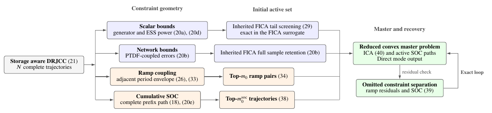

# EIFICA

**Distributionally robust automatic generation control (AGC) scheduling with cumulative state of charge constraints**

Companion repository for *“Data Driven Distributionally Robust Scheduling of AGC Participation Factors with Cumulative State of Charge Constraints: A Constraint Geometry Guided Convex Approximation.”*

Envelope informed fast inner convex approximation (EIFICA) extends the fast inner convex approximation (FICA) computational framework to AGC adjusted generator ramps and affine cumulative deployed state of charge (SOC). Temporal envelopes initialize reduced ramp and SOC constraint sets. Exact EIFICA iteratively adds violated constraints until omitted temporal constraint residuals satisfy the prescribed tolerance.

[](figures/manuscript/Figure1.pdf)

*Constraint geometry and solution workflow from Figure 1 of the manuscript.*

## Quick start

Create the Conda environment from the repository root:

```bash
conda env create -f environment.yml
conda activate eifica-agc
```

Run the RTS-24 optimization example:

```bash
python examples/run_cumulative_soc.py --method Exact --n 100 --seed 0
```

Generate Figures 3–12 from the included plotting data:

```bash
python visualization/plot_manuscript.py
```

The optimization example requires a valid Gurobi license. The figure command does not require a solver license and writes PDFs to `figures/reproduced/`. See the [figure guide](visualization/README.md) for the individual data sources and Figures 1 and 2.

## Repository contents

| Material | Location |
| --- | --- |
| Optimization implementation | [`src/eifica_optimizer.py`](src/eifica_optimizer.py) |
| Renewable trajectory generation | [`src/renewable_scenarios.py`](src/renewable_scenarios.py) |
| RTS-24 cumulative SOC example | [`examples/run_cumulative_soc.py`](examples/run_cumulative_soc.py) |
| Processed forecast and error data | [`data/processed/`](data/processed/) |
| Figure data and plotting scripts | [`data/figures/`](data/figures/), [`visualization/`](visualization/) |
| Manuscript figure PDFs | [`figures/manuscript/`](figures/manuscript/) |

## Reference environment

| Component | Configuration |
| --- | --- |
| Operating system | Ubuntu 22.04.5 |
| Processors | 2 × Intel Xeon Platinum 8378A, 3.00 GHz |
| Python | 3.9.19 |
| Optimization solver | Gurobi 12.0.3 |
| Network modeling | pandapower 2.14.6 |

Package versions are specified in [`environment.yml`](environment.yml). The hardware configuration matches that reported in the manuscript.

## Data provenance

The processed renewable data draw on the [GEFCom2012 wind forecasting benchmark](https://www.kaggle.com/competitions/GEF2012-wind-forecasting) and the Elia Open Data portals for [historical wind](https://opendata.elia.be/explore/dataset/ods031/) and [photovoltaic data](https://opendata.elia.be/explore/dataset/ods032/). Original datasets remain available from their providers under the applicable terms.

## Citation and license

Please cite the associated manuscript when using these materials. Repository metadata are in [`CITATION.cff`](CITATION.cff). The code is released under the [MIT License](LICENSE).
